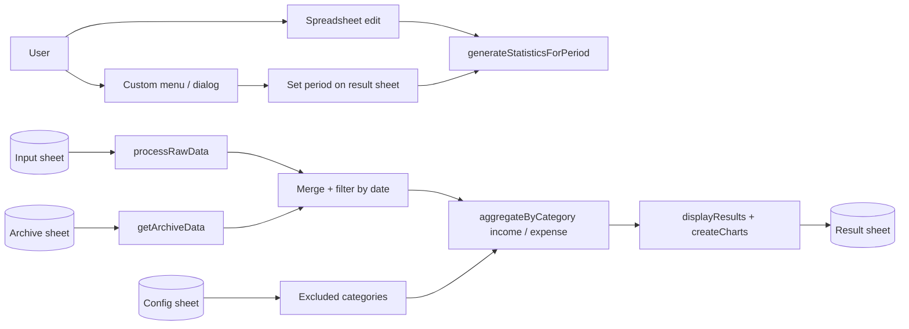

# Architecture Overview

This document describes how `kakeibo-gas` is structured **today**, in the [architecture.md](https://architecture.md/) format. Decisions and planned changes live in [`docs/adrs/`](adrs/).

## 1. Project Structure

```text
kakeibo-gas/
├── src/
│   ├── main.ts                    # Entry points, menu, dialogs, charts, archive flow, wiring
│   ├── config.ts                  # STATIC_CONFIG: date format, column indexes, chart sizes
│   ├── testing/                   # Fakes shared by unit tests (`*.testing.ts`)
│   ├── types.ts, types/           # Shared types (overlapping definitions, see section 9)
│   └── features/                  # Package by Features
│       ├── aggregation/           # aggregateByCategory, findUnlistedCategories
│       ├── archive/               # getArchiveData, getOrCreateArchiveSheet, planArchive, filterZeroRecords
│       ├── category/              # CategoryCatalog, parseKindWord
│       ├── chart/                 # resolveChartRange
│       ├── config/                # initializeConfigSheet, readConfigSheet, getDefaultConfigRows, defaultConfigRows.{ja,en}, types
│       ├── data/                  # processRawData (raw sheet rows -> TransactionData)
│       ├── date/                  # calculatePeriodDates, formatDateToString, startOfDayInZone
│       ├── dialog/                # buildPeriodDialogHtml
│       ├── input/                 # getOrCreateInputSheet
│       ├── locale/                # ja / en dictionaries, resolveLocale, detectLocale
│       └── result/                # displayResults (summary and category tables)
├── tests/
│   ├── __mocks__/                 # Fakes for GAS globals
│   ├── architecture/              # Source-scanning guard tests
│   └── integration/               # Feature functions combined, without main.ts
├── docs/                          # Architecture, development guide, ADRs
├── .github/                       # CI, release workflow, issue/PR templates, Dependabot
├── appsscript.json                # GAS manifest (time zone, runtime, logging)
├── rollup.config.js               # Bundles src/ into dist/main.js and strips `export`
├── justfile, .nvmrc, biome.json   # Tooling
└── README.md
```

Unit tests sit next to the source as `*.test.ts`.

## 2. High-Level System Diagram

The script is bound to one spreadsheet. A user action (menu click, or an edit if the trigger is installed) sets the aggregation period; the script then reads transactions, aggregates them, and writes tables and charts back.



Boundaries: pure logic lives under `src/features/`; spreadsheet I/O, UI, and composition live in `src/main.ts`.

### Runtime model

| Concern | How it works |
| :--- | :--- |
| Entry points | Functions assigned to `globalThis` at the bottom of `src/main.ts`; GAS resolves menu items and `google.script.run` calls by global name |
| `onOpen` | Simple trigger; builds the custom menu |
| `generateStatistics` | Written to run on spreadsheet edit. The code does not install the trigger (`ScriptApp.newTrigger` is not used), so it must be wired up in the Apps Script project |
| Throttling | `generateStatistics` skips a run that follows another within 10 seconds, using `CacheService` |
| Configuration | Nothing is read at script load. `onOpen` creates the config sheet if it is missing; it is read when the aggregation or the input sheet needs its values |
| `onOpen` failures | `onOpen` builds the menu first and then creates the config sheet. If the config sheet cannot be created, the menu still appears and the failure is only logged with `console.error`; nothing is shown to the user. The config sheet is created again the next time its values are needed |

## 3. Core Components

### 3.1 Frontend

- **Name**: Spreadsheet UI
- **Description**: A custom menu (`onOpen`) with period shortcuts (current month, last month, current year), a custom-period dialog, archive, and input-sheet reset. The dialog HTML is built by `buildPeriodDialogHtml`, which escapes the locale text it embeds, and served by `HtmlService`; confirmations and errors use `ui.alert`.
- **Technologies**: Google Sheets UI, `HtmlService`, `google.script.run`
- **Deployment**: Shipped inside `dist/main.js`

### 3.2 Backend Services

A single GAS script; each feature below is a directory under `src/features/`.

#### 3.2.1 Composition root (`src/main.ts`)

- **Description**: Wires the features together, builds charts, and runs the archive flow. Creating the input sheet and writing the result tables are delegated to `features/input` and `features/result`; `main.ts` supplies the active spreadsheet, locale, and type options. About 700 lines. Text and sheet names come from `getActiveLocale()`, which detects the language once per execution with `detectLocale`. Chart ranges come from the section positions that `displayResults` (in `features/result`) returns, resolved by `resolveChartRange` in `features/chart`.
- **Technologies**: TypeScript, GAS services
- **Deployment**: Bundled into `dist/main.js`
- **Archive flow** (steps 2 to 4 and 6 are the pure `planArchive`):
  1. Confirm with the user (dialog).
  2. Walk the input rows, carrying forward the last seen date and type into rows that leave them blank.
  3. Split rows into "before this month" (moved) and "this month or later" (kept); accumulate a balance per type from the moved rows.
  4. Zero the amounts on carryover rows being archived, so carryover is not counted as income or expense.
  5. Drop zero-amount records, append the rest to the archive sheet, and clear the input rows.
  6. Write one carryover row per type (the locale's carryover category, `収入-繰越金` in `ja`) back to the input sheet, dated the first of this month.

#### 3.2.2 Feature modules (`src/features/*`)

| Feature | Responsibility | Takes GAS objects | Tests |
| :--- | :--- | :--- | :--- |
| `aggregation` | Group transactions by category group, using the catalog's kind and exclusions; find categories the config sheet does not list | No | Unit |
| `archive` | Read the archive sheet, create it, plan an archive run (`planArchive`), drop zero-amount records | `getArchiveData`, `getOrCreateArchiveSheet` | Unit (fakes for the sheet helpers) |
| `category` | The category catalog (kind and exclusion per category) and the reading of the income/expense words | No | Unit |
| `chart` | Resolve the sheet range a chart reads from a result-table section | No | Unit |
| `config` | Read the config sheet; create a new one with the locale's default rows, checkboxes, and dropdown | `readConfigSheet`, `initializeConfigSheet` | Unit (fakes) |
| `data` | Convert raw rows to `TransactionData`, carrying forward date and type | No | None directly |
| `date` | Period boundaries and date formatting | No | Unit |
| `dialog` | Build the custom-period dialog HTML from the locale text | No | Unit |
| `input` | Create the input sheet: header row, styles, date and amount formats, type dropdown | `getOrCreateInputSheet` | Unit (fake spreadsheet) |
| `locale` | Text dictionaries (`ja`, `en`) and the rule that picks one for a spreadsheet. `detectLocale` reads a spreadsheet's sheet names and locale and picks the dictionary | No (a minimal spreadsheet interface) | Unit |
| `result` | Write the summary and the income and expense tables to the result sheet, and return their row ranges | `displayResults` | Unit (fake sheet) |

`src/main.ts` has no tests of its own; the code that creates the input sheet and writes the result tables was moved out so that it is covered (`features/input`, `features/result`). Result sheet creation (`getOrCreateResultSheet`), the charts, and the archive flow still live in `main.ts` untested. `tests/architecture/` scans the production sources and fails on a Japanese string literal outside the `ja` dictionary (only `features/config/defaultConfigRows.ja.ts`, the Japanese default config rows, is exempt). `tests/integration/` combines feature functions (config reading with aggregation, archive sheet creation with archive reading) but does not run `main.ts`. The fake spreadsheet in `src/testing/` keeps one final state per A1 range (value, format, style, validation), so a test can check what a range ended up as but not the order of writes, and a write to an overlapping range is not merged into another.

## 4. Data Stores

### 4.1 Google Sheets

- **Type**: Spreadsheet tabs in the bound spreadsheet
- **Purpose**: Source data, archive, configuration, and output
- **Key schemas**:

| Sheet | Name in the `ja` locale (`locale.sheets`) | Created by | Role |
| :--- | :--- | :--- | :--- |
| Input | `入力` | `getOrCreateInputSheet` | Current transactions, columns A–F |
| Result | `結果` | `getOrCreateResultSheet` | Aggregation output and the period cells (`B2`, `D2`) |
| Archive | `アーカイブ` | `getOrCreateArchiveSheet` | Transactions moved out of the input sheet, same columns as the input sheet |
| Config | `設定` | `initializeConfigSheet` | Type options, and for each category whether it is income or expense (column D) and whether it is excluded from aggregation (column C) |

Input and archive columns: date, type, category, description, income, expense (A–F). Column G onward is left untouched for the user's own formulas. In the maintainer's live spreadsheet, column G is a total and the columns after it hold one balance per type, headed by the config sheet's types in the same order; the script never writes them (observed from exports of the sheets, so the formulas themselves are not recorded here).

**Category grammar.** A category is a hyphen-separated string, `<kind>-<group>[-<item>]`, for example `支出-食費-外食`. What the code does with it:

- Whether a category is income or expense comes from the config sheet's income/expense column (column D), read by `readConfigSheet` into a `CategoryCatalog`. The wording of the name is not consulted. A category whose cell is empty or not an income/expense word makes the aggregation stop with an error that names it, and so does a category in the selected period's transactions that the config sheet does not list. The config sheet is therefore the list of every category in use: removing one makes the periods that still contain it fail until it is added back. A category listed twice keeps its first row.
- Aggregation groups by the **second segment** of the name. This is the part of the grammar that still depends on how names are written.
- Exclusion matches the **whole** category name flagged in column C. The note on the result sheet lists the segment after the last hyphen of each excluded category (`収入-繰越金` is shown as `繰越金`).
- The carryover category is identified by name: `planArchive` matches the locale's `carryoverCategory`, so that category has to exist in the config sheet, with the income kind.

### 4.2 Script cache

- **Type**: `CacheService` script cache
- **Purpose**: Throttle repeated `generateStatistics` runs (key `lastRun_generateStats`, 60 seconds)

## 5. External Integrations / APIs

| Service | Purpose | Integration method |
| :--- | :--- | :--- |
| Google Apps Script services (`SpreadsheetApp`, `HtmlService`, `CacheService`, `Charts`) | Read and write sheets, show UI, cache, build charts | Global objects provided by the GAS runtime (types from `@types/google-apps-script`) |
| `clasp` | Upload the bundle to the Apps Script project | Developer CLI, run locally; not used by CI |

## 6. Deployment & Infrastructure

- **Cloud Provider**: Google (Apps Script runtime, V8)
- **Key Services Used**: Google Sheets, Apps Script
- **CI/CD Pipeline**: GitHub Actions. `ci.yml` runs Biome, `tsc --noEmit`, Vitest, and the Rollup build on pushes to `main` and on pull requests. `release.yml` runs on `v*` tags, builds `dist/main.js`, and attaches it to a GitHub Release. Nothing deploys to Google automatically; users paste `main.js` into the Apps Script editor, or developers run `clasp push`.
- **Monitoring & Logging**: `console.log` / `console.error` in the script; the manifest sets `exceptionLogging` to `STACKDRIVER`

## 7. Security Considerations

- **Authentication**: The script runs as the Google account using the spreadsheet; there is no separate login.
- **Authorization**: The manifest declares no `oauthScopes`, so scopes are inferred by Apps Script from the services the code uses.
- **Data Encryption**: Data stays in Google Sheets; encryption is Google's.
- **Key Security Tools/Practices**: No secrets in the repository. GitHub Actions are pinned by commit SHA and run with `contents: read` (`contents: write` only for the release job). See [`SECURITY.md`](../SECURITY.md).

## 8. Development & Testing Environment

- **Local Setup Instructions**: See [`CONTRIBUTING.md`](../CONTRIBUTING.md) and [`docs/development.md`](development.md). Node.js is pinned in `.nvmrc`.
- **Testing Frameworks**: Vitest (Red/Green TDD, Detroit school; mocks only for GAS globals)
- **Code Quality Tools**: Biome (lint and format), `tsc --noEmit`, pre-commit, markdownlint

## 9. Future Considerations / Roadmap

Localization was tracked in [issue #28](https://github.com/connect0459/kakeibo-gas/issues/28) and is described in [ADR-001](adrs/adr-001-locale-resolution-and-category-kind.md). Text, sheet names, headers, and the carryover and fallback category names live in the locale dictionaries (`src/features/locale`); `ja` holds the original Japanese text and `en` an English one. `getActiveLocale()` in `main.ts` picks the dictionary once per execution: a spreadsheet that already has the script's sheets keeps their language, and otherwise the spreadsheet locale decides. Nothing is stored. Income and expense no longer depend on the wording of the category name. A new config sheet is created from the default rows of the active locale (`features/config/getDefaultConfigRows`): the exclusion column is a checkbox and column D a dropdown of that language's words, down to row 1000, and both reject other input when it is typed (a paste bypasses validation; a wrong value is caught when the aggregation runs). Existing config sheets are left as they are.

Dates follow the spreadsheet's time zone, as decided in [ADR-002](adrs/adr-002-follow-the-spreadsheet-time-zone.md). `getActiveTimeZone()` in `main.ts` reads `getSpreadsheetTimeZone()` and passes it to the date, archive, and filter functions as an argument; none of them reads a global or defaults to a zone.

Known architectural debt, recorded as facts about the current code rather than commitments:

- `src/main.ts` mixes UI, sheet I/O, and chart construction, and the result sheet's creation and the charts are not tested. `planArchive` repeats the date and type carry-forward that `processRawData` already implements.
- Archiving zeroes the amounts of old carryover rows and the zero-amount filter then drops them, so they never reach the archive sheet; the balance travels in the new carryover rows (pinned by the `planArchive` tests).
- `main.ts` uses literal column indexes and the literal width `6` instead of the column definitions in `STATIC_CONFIG`.
- `getArchiveData` and `getOrCreateArchiveSheet` still import `STATIC_CONFIG` for the column definitions and date format; only the sheet names and headers are passed in.
- `TransactionData` is defined in four places (`src/types.ts`, `src/types/index.ts`, `features/aggregation/types.ts`, `features/data/processRawData.ts`), as both `type` and `interface`.
- `src/types.ts` shadows `src/types/index.ts`: an import of `"./types"` resolves to the file, so no import reaches the directory's `index.ts`. Both declare `BalanceByType`, `CategoryAggregation`, `SectionPosition`, and `SectionsMap` as well. The directory is still compiled, because `src/types/global.d.ts` lives in it.
- `filterDataByDate` contains debug logging for the hard-coded date `2025-04-01`.
- `displayResults` reports a section it did not write as `{ start: 0, end: 0 }`, and callers treat `start <= 0` as "not written". The type cannot express "absent". The chart code uses only `start` and the data row count, so `SectionPosition.end` is currently unused.
- TypeScript is pinned to 6.x until `@rollup/plugin-typescript` supports 7.

## 10. Project Identification

- **Project Name**: kakeibo-gas
- **Repository URL**: <https://github.com/connect0459/kakeibo-gas>
- **Primary Contact/Team**: [connect0459](https://github.com/connect0459)
- **Date of Last Update**: 2026-10-20

## 11. Glossary / Acronyms

- **GAS**: Google Apps Script, the JavaScript runtime attached to Google Workspace documents.
- **Kakeibo**: Japanese household budget ledger.
- **Type (分類)**: How money is held: cash, a bank account, e-money. Independent of category.
- **Category (科目)**: The income or expense classification of a row, in the `<kind>-<group>[-<item>]` form.
- **Carryover (繰越金)**: The balance per type carried into the current month when earlier data is archived.
- **Excluded category**: A category flagged in the config sheet that is left out of aggregation (carryover, type transfer).
- **Config sheet**: The sheet that holds type options, category options, and exclusion flags.
- **clasp**: Google's CLI for developing Apps Script projects locally.
